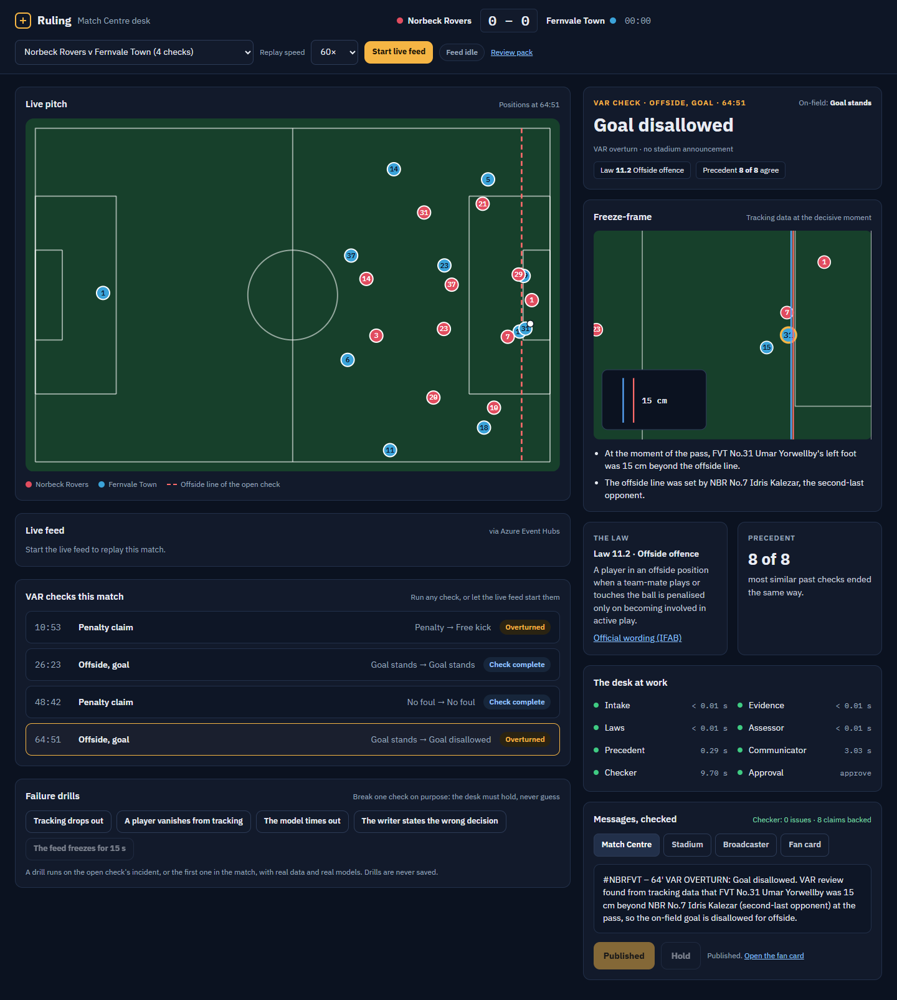
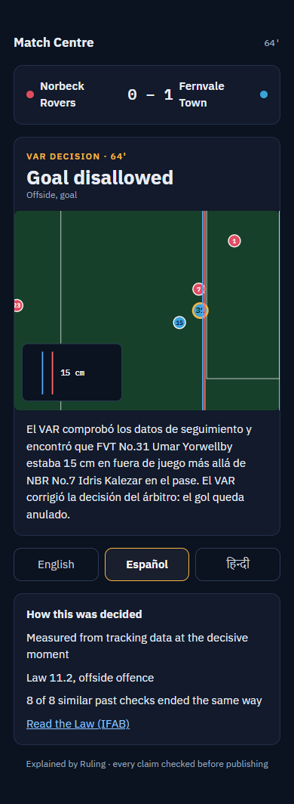
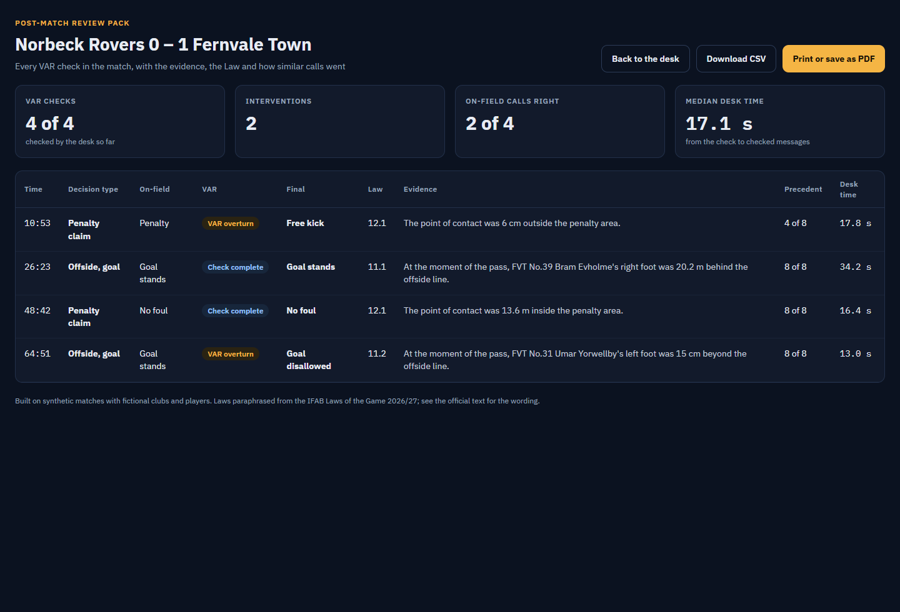
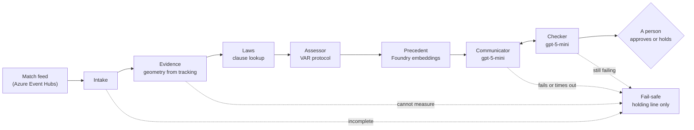
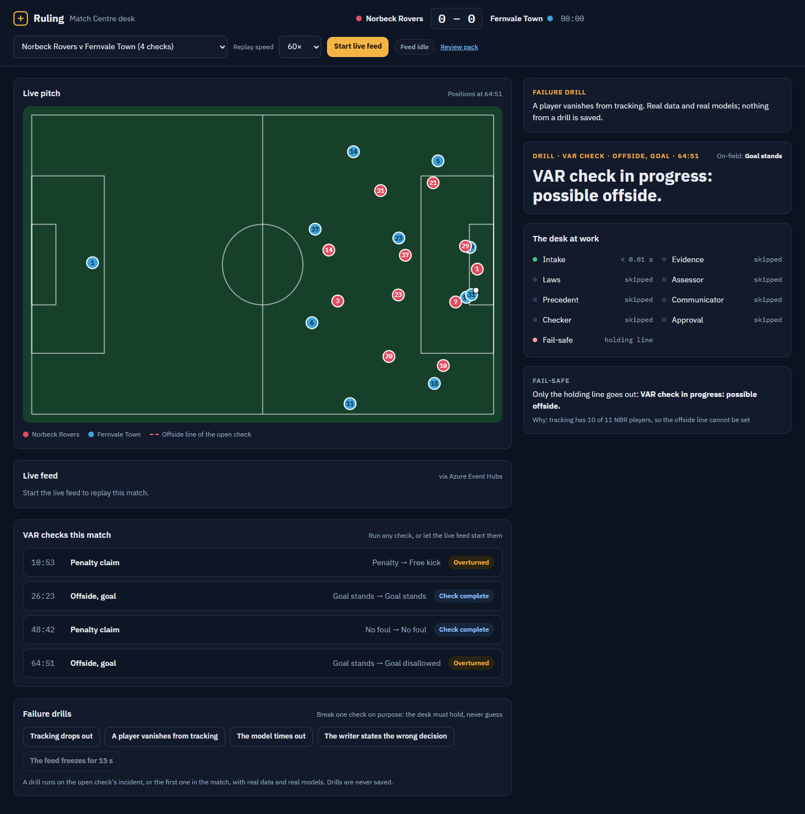
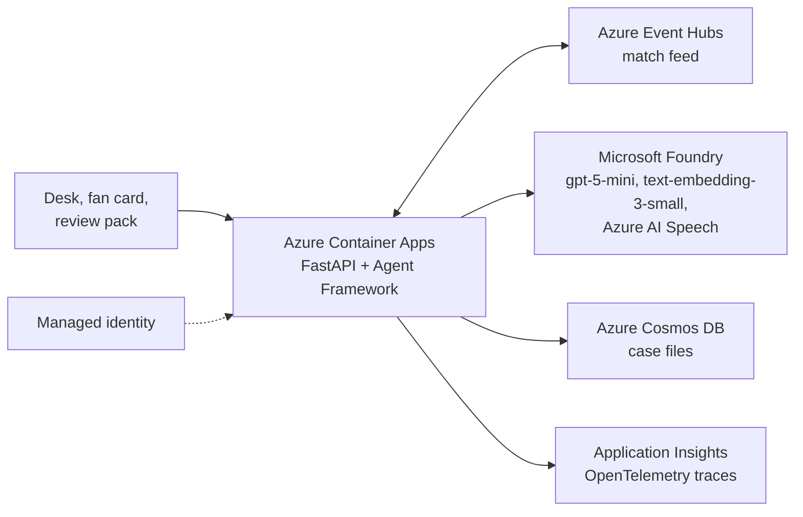

# Ruling

**A decision desk for VAR calls.** When the video assistant referee checks a goal, a penalty or a red card, Ruling measures the decision from tracking data, finds the Law that governs it and how similar calls went, writes the explanation for the stadium, the league's Match Centre, broadcasters and fans, and checks every claim before a person approves it. When it cannot be sure, it holds and says only what it knows.

**Live:** https://ruling-api.proudsea-2ac99296.eastus2.azurecontainerapps.io (API reference at `/docs`)



Everything runs on synthetic, football-realistic matches with fictional clubs and players.

## Try it in two minutes

No sign-in is needed.

1. Open the desk at [the 63rd minute of a demo match](https://ruling-api.proudsea-2ac99296.eastus2.azurecontainerapps.io/?seed=5004&from=63) and press **Start live feed**. The match plays through Azure Event Hubs; when the 64:51 goal arrives and the VAR checks it, the desk opens the check by itself and its agents light up one by one.
2. When **Approve and publish** turns amber, press it. Nothing goes out before that. Then **Open the fan card** and switch it to Español or हिन्दी.
3. Under **VAR checks this match**, run the 10:53 penalty claim. The VAR overturns it, so a stadium announcement is due: open the **Stadium** tab and press **Hear the announcement**, and Azure AI Speech reads the referee's checked words.
4. Under **Failure drills**, press **A player vanishes from tracking**: the desk refuses to measure an offside line it cannot see and holds, saying why. Try **The model times out** and **The writer states the wrong decision** too.
5. Open the **Review pack** for the whole match as a table, a CSV or a PDF.
6. Point an MCP client at `/mcp` (see below) and ask it to explain a VAR check.

## A check, start to finish

A goal goes in at 64:51 and the VAR checks it for offside. Within about 20 seconds the desk has:

- **measured it:** the scorer's left foot was 15 cm beyond the line set by the second-last defender, at the moment of the pass;
- **found the Law:** Law 11.2, offside offence;
- **looked up precedent:** 8 of the 8 most similar past checks ended the same way;
- **written four messages:** a Match Centre post, a stadium announcement when one is due, three bullets for a broadcaster's referee analyst, and a fan card of 60 words or fewer;
- **checked them:** every factual claim is compared with the measurements and the Law, and a draft that fails goes back to be rewritten.

Nothing goes out until a person approves it. When the referee announces the decision in the stadium, the checked announcement can be played for the PA, read by Azure AI Speech word for word. The fan card can then be switched to Spanish or Hindi (French and Portuguese too, through the API), with names and figures kept exactly. After the match, a review pack lists every check with its evidence, Law and precedent, as a table, a CSV or a PDF.

<p>
  
  
</p>

## How the desk works

The desk is a workflow on Microsoft Agent Framework. Numbers come from code; the model only writes and checks words.



| Step | What it does | How |
|---|---|---|
| Intake | Refuses a packet whose tracking is missing a player the decision depends on | code |
| Evidence | Offside margins, contact points, distances from the penalty area, DOGSO factors | code (geometry) |
| Laws | The governing clause of the IFAB Laws of the Game 2026/27 | code (lookup) |
| Assessor | The VAR outcome: check complete, VAR overturn, or on-field review | code (protocol) |
| Precedent | The most similar checks in a 487-check archive and how they ended | Foundry embeddings |
| Communicator | The four messages, from the measured facts only | gpt-5-mini |
| Checker | Code rules, then every claim against the decision record; up to two rewrites | code + gpt-5-mini |
| Approval | A person approves or holds; nothing is published before | human in the loop |
| PA voice | The checked stadium announcement, read aloud word for word | Azure AI Speech |

## When it refuses to guess

- **Incomplete tracking.** The offside line comes from the second-last defender. If tracking loses that player, the line silently moves to the next one and the measurement still looks exact. On the demo matches, 7 of the 39 offside checks would have wrongly disallowed a good goal. The desk now knows how many players each side has on the pitch and holds any check that is missing one.
- **Time limits.** Each model call has a time limit, and every check has a 90-second deadline. Past it, only a holding line goes out, built from what had been established, for example "VAR check complete: the goal is disallowed."
- **Claims that fail the check.** A draft goes back to the writer at most twice. If it still fails, the check is held.
- **Disagreement with precedent.** If the measured decision differs from how most similar checks ended, the person approving sees a flag. Precedent never overrides the measurement.
- **A stale feed.** If the match feed stops for 8 seconds, the desk says so and says when it resumes. Duplicate and leftover events never start a second check.

The desk has a **Failure drills** panel, so anyone can break a check on purpose with real data and real models: tracking drops out, a player vanishes from tracking, the model times out, the writer states the wrong decision, or the feed freezes. Drills are never saved.



## Results

Tested on 80 held-out synthetic matches (328 VAR checks) against gpt-5-mini reading the same raw data, as pre-registered in [docs/eval-plan.md](docs/eval-plan.md) before any data existed. Full results: [docs/results.md](docs/results.md).

| | Model alone | Ruling |
|---|---|---|
| Right decision and card | 89.3% | **100%** |
| Right decision on the 61 contested calls | 77.0% | **100%** |
| Right Law clause | 8.5% | **100%** |
| Correct on-field calls it would have overturned | 25 | **0** |
| Fan cards leaking raw data (player ids, coordinates, field names) | 85.4% | **0%** |
| Unsupported claims in the fan cards | 3.5% | 2.6% |
| Median time per check | 11.0 s | 18.4 s |
| Cost per check | $0.0036 | $0.0043 |

The decision difference is +10.7 points (95% CI +7.6 to +14.0). The pre-registered test also required fewer unsupported claims, with an interval excluding zero. The difference, −0.9 points (95% CI −2.6 to +0.8), favours the desk but does not meet that bar, so **the pre-registered success test is not met**. Most of the desk's flagged claims were the phrase "it was a close call", which the independent judge had no record to verify.

As an exploratory check, Microsoft Foundry's groundedness evaluator scored the fan cards 4.67 out of 5 for the desk and 4.53 for the model alone (difference +0.14, 95% CI +0.003 to +0.284).

## Use the desk from an assistant (MCP)

The desk is also an MCP server, so GitHub Copilot, a Foundry agent or any MCP client can use it as a tool:

| Tool | What it returns |
|---|---|
| `list_var_checks` | the VAR checks in a demo match, never the correct outcome |
| `explain_var_check` | a real desk check: the decision measured from tracking data, the Law clause, precedent, the four checked messages and, when one is due, a link to the spoken stadium announcement; nothing is published until a person approves it on the desk |
| `law_clause` | a Law of the Game as the desk paraphrases it, with its criteria and the official link |
| `similar_past_checks` | how the most similar archived checks ended (Foundry embeddings) |

In VS Code (`.vscode/mcp.json`):

```json
{ "servers": { "ruling": { "type": "http", "url": "https://ruling-api.proudsea-2ac99296.eastus2.azurecontainerapps.io/mcp" } } }
```

The public demo limits how often one client can start checks and caps model use per hour, so it stays available to everyone.

## Built on Azure



- **Microsoft Foundry:** gpt-5-mini writes and checks the messages and translates the fan card; text-embedding-3-small powers precedent search. The groundedness evaluator is used in the evaluation.
- **Azure AI Speech** reads the checked stadium announcement aloud for the PA in a British neural voice. It runs on the same Foundry resource and signs in with the same managed identity.
- **Microsoft Agent Framework:** the desk is a workflow of executors with switch-case edges, a writer-checker loop, a fail-safe path, and human-in-the-loop approval through `request_info`. Its spans go to Application Insights.
- **Azure Container Apps** runs the API and the desk. **Azure Event Hubs** carries the live match feed, and a VAR check arriving on the feed starts the desk on its own. **Azure Cosmos DB** keeps finished case files for the review pack.
- **Managed identity** everywhere: no keys in the app. Infrastructure is Bicep, deployed with the Azure Developer CLI.

## The synthetic data

A match generator builds possession chains calibrated to public league aggregates, for 20 fictional clubs, with 22-player freeze-frames at every key moment. Incident planners create offside checks, penalty claims, handball claims, handball before a goal and possible red cards. Law judges written from the IFAB Laws decide the correct outcome. On-field errors are planted at higher rates than in real matches, so that there are enough contested decisions to test.

| Set | Seeds | Use |
|---|---|---|
| Development | 5001-5020 | building and the live demo |
| Archive | 1-120 | the precedent library |
| Held-out | 9001-9080 | the final evaluation only; the API never serves it |

## Run it

You need Python 3.12, [uv](https://docs.astral.sh/uv/), the [Azure Developer CLI](https://learn.microsoft.com/azure/developer/azure-developer-cli/) and an Azure subscription with access to Microsoft Foundry.

```sh
uv sync
azd auth login
azd provision                      # Foundry, Container Apps, Event Hubs, Cosmos DB, App Insights
uv run ruling-desk precedents      # embed the archive into the precedent index
azd deploy                         # build the image and deploy the app
```

Locally, settings come from the azd environment (`FOUNDRY_PROJECT_ENDPOINT`, `FOUNDRY_CHAT_MODEL`, `FOUNDRY_EMBEDDING_MODEL`). Without `EVENTHUB_NAMESPACE` and `COSMOS_ENDPOINT`, the feed runs in process and case files stay in memory.

```sh
uv run uvicorn ruling.api.app:app --reload     # the desk at http://127.0.0.1:8000
uv run ruling-desk check 5004 --category offside
uv run python -m pytest
uv run ruling-eval --set dev                   # the evaluation on the development seeds
```

## API

| Route | |
|---|---|
| `GET /api/matches`, `GET /api/matches/{seed}` | demo matches, events and incidents (never the correct outcome) |
| `GET /api/incidents/{id}` | the check packet the desk works from |
| `POST /api/checks` | start a check `{"incident_id", "auto_approve", "drill"}` |
| `GET /api/checks/{id}`, `GET /api/checks/{id}/events` | the case file, and every agent step as it happens (server-sent events) |
| `POST /api/checks/{id}/decision` | approve or hold |
| `POST /api/checks/{id}/translate` | the published fan card in Spanish, Hindi, French or Portuguese |
| `GET /api/checks/{id}/announcement` | the checked stadium announcement, spoken (MP3, Azure AI Speech) |
| `GET /api/cases?match_id=` | finished case files, for the review pack |
| `POST /api/live`, `GET /api/live/events` | replay a match through Event Hubs, and follow it |
| `GET /api/drills`, `POST /api/live/stall` | failure drills |
| `POST /mcp` | the desk as MCP tools (streamable HTTP) |

## Repository

| Path | |
|---|---|
| `src/ruling/sim` | the match generator |
| `src/ruling/incidents`, `src/ruling/laws` | incident planners, Law judges and the VAR protocol |
| `src/ruling/desk` | the desk: packet, evidence, assessor, precedent, communicator, checker, workflow, drills |
| `src/ruling/api` | FastAPI app, live checks, the Event Hubs feed, Cosmos DB store, telemetry |
| `src/ruling/eval` | arms, scoring and the claim audit |
| `web/` | the desk, fan card and review pack |
| `infra/` | Bicep for every Azure resource |
| `docs/` | the pre-registered evaluation plan and the results |

## Limitations

- **The correct outcomes are our own encoding of the Laws.** The desk computes the same geometry the generator used, so its edge on factual calls is expected by design. The informative results are the subjective calls, the claims in the explanations, and the behaviour under failure.
- **Synthetic incidents simplify real ones:** points and labelled attributes instead of video.
- **The Laws are paraphrased,** with clause references and links to the official text.
- **Not covered:** mistaken identity, the ball going out of play before a goal, and two incidents in one passage of play.
- **A model still writes the words.** The checker catches most mistakes, but not every one: in failure drills it caught a planted wrong decision in 46 of 47 measured runs.
- **One replica.** A check in progress lives in memory; finished checks are in Cosmos DB and survive a restart.


## License

MIT
